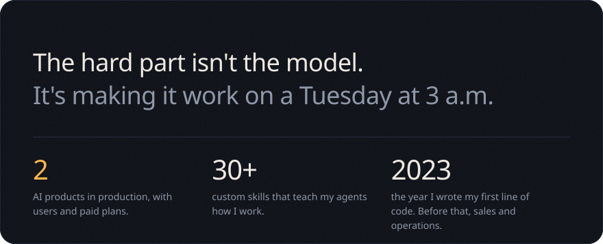
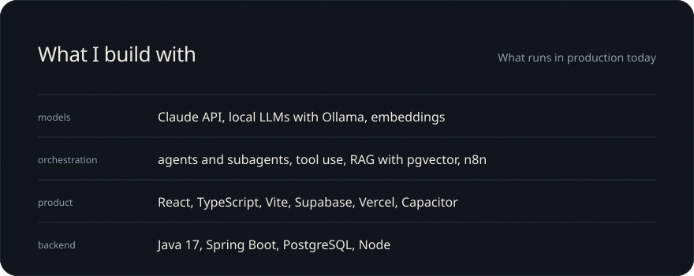

<a href="https://github.com/SamaelFL">Español</a> · <b>English</b>

<!-- changelog:start -->
<!-- changelog:end -->

Every image on this profile comes from code: <code>scripts/build.py</code> draws the office box by box.

