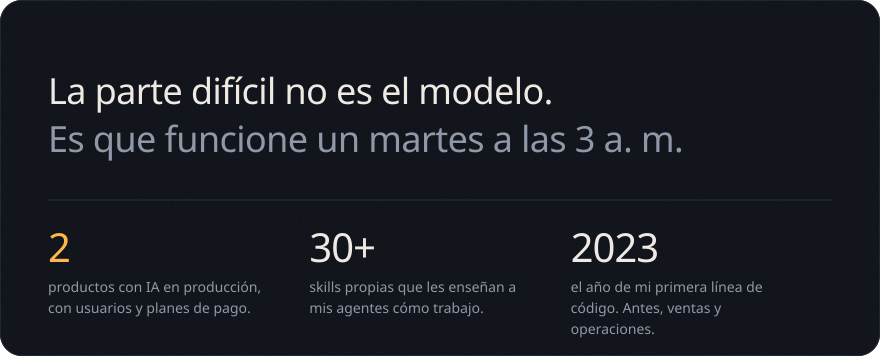
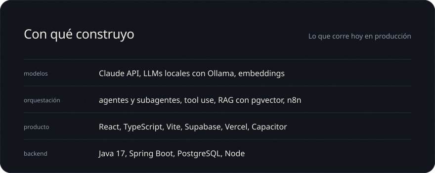
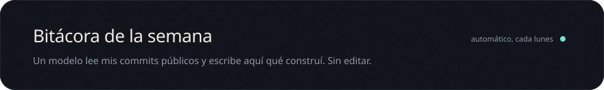
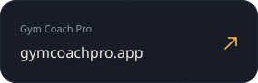
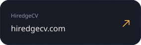

<!-- changelog:start -->
_Todavía no hay corridas: el primer resumen llega el lunes después del primer commit público._
<!-- changelog:end -->

Cada imagen de este perfil sale de código: <code>scripts/build.py</code> dibuja la oficina caja por caja.

