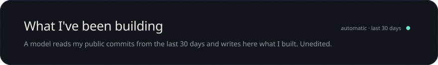

<b>Read in English</b>

 

<!-- changelog-en:start -->

- I renamed Chambeadores and added a live demo with its GIF in the README.
- I built a nighttime isometric virtual office, with a whip to keep the team moving.
- I configured the router to send easy tasks to Sonnet, cutting costs compared to Opus.

last 30 days · summarized by a model from 8 commits in 3 repos · last commit: 2026-10-25
<!-- changelog:hash:2ad61da5b73f -->
<!-- changelog-en:end -->

Every image on this profile comes from code: <code>scripts/build.py</code> draws the office box by box.

<b>Español</b>

 

<!-- changelog:start -->

- Renombré Chambeadores y agregué una demo en línea con su GIF en el README.
- Construí una oficina virtual isométrica nocturna, con un látigo para mover el ritmo del equipo.
- Configuré el enrutador para mandar tareas sencillas a Sonnet, bajando costos frente a Opus.

últimos 30 días · resumido por un modelo a partir de 8 commits en 3 repos · último commit: 2026-10-25
<!-- changelog:hash:2ad61da5b73f -->
<!-- changelog:end -->

Cada imagen de este perfil sale de código: <code>scripts/build.py</code> dibuja la oficina caja por caja.

