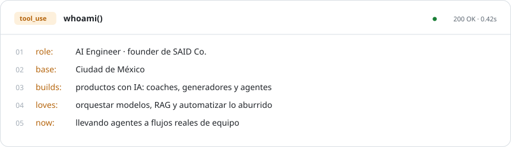
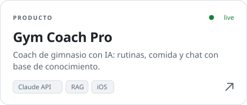
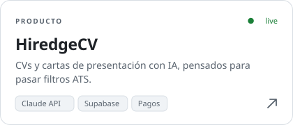
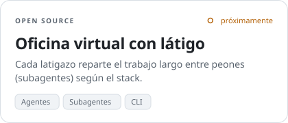
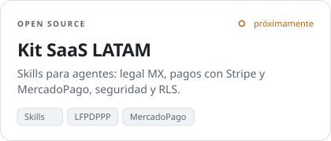
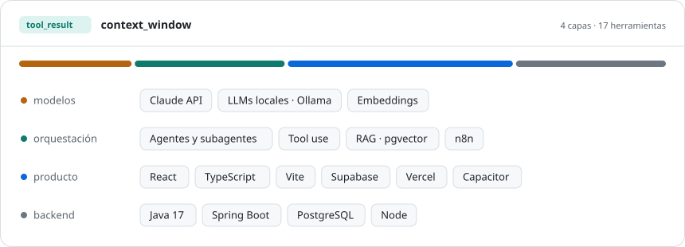
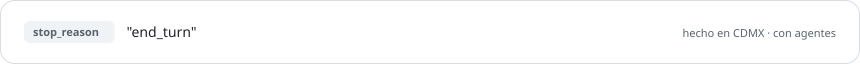

<a href="https://github.com/SamaelFL"><picture><source media="(prefers-color-scheme: dark)" srcset="assets/banner-dark.svg"></picture></a>

### `01 tool_use` whoami()

<picture><source media="(prefers-color-scheme: dark)" srcset="assets/whoami-dark.svg"></picture>

### `02 tool_use` list_deployments()

<a href="https://gymcoachpro.app"><picture><source media="(prefers-color-scheme: dark)" srcset="assets/deploy-1-dark.svg"></picture></a>
<a href="https://hiredgecv.com"><picture><source media="(prefers-color-scheme: dark)" srcset="assets/deploy-2-dark.svg"></picture></a>

<a href="https://github.com/SamaelFL"><picture><source media="(prefers-color-scheme: dark)" srcset="assets/deploy-3-dark.svg"></picture></a>
<a href="https://github.com/SamaelFL"><picture><source media="(prefers-color-scheme: dark)" srcset="assets/deploy-4-dark.svg"></picture></a>

### `03 tool_result` context_window

<picture><source media="(prefers-color-scheme: dark)" srcset="assets/stack-dark.svg"></picture>

### `04 tool_result` weekly_changelog

<!-- changelog:start -->
> Todavía no hay corridas. Cada lunes un modelo lee mis commits públicos de la semana y escribe aquí qué construí.
<!-- changelog:end -->

<picture><source media="(prefers-color-scheme: dark)" srcset="assets/footer-dark.svg"></picture>
